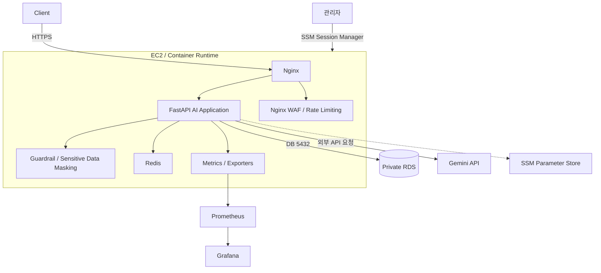

# 클라우드 아키텍처

Heimdall은 외부 AI API를 연동하는 과정에서 관리 경로, 데이터 저장, 요청 통제, 장애 대응을 나누어 구성한 프로젝트입니다.

이 그림은 구현된 구성요소의 역할을 보여 주기 위한 요약입니다. 세부 적용 순서와 실제 연결은 [기존 설계 문서](architecture.md) 및 [프로젝트 기록](https://app.notion.com/p/3b559c941225804ebe80cdbe1b098115)에서 확인할 수 있습니다.

추가 실습으로 진행한 OIDC, CI 검사, Terraform, DR, FinOps는 주된 요청 흐름과 구분했습니다. 각 검증의 범위를 넘어서 상시 운영되는 환경이라고 설명하지 않습니다.
