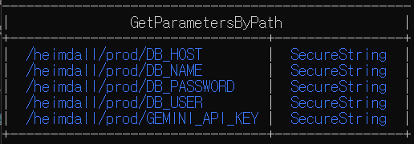
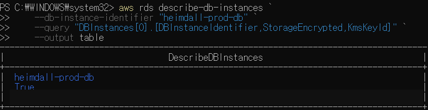
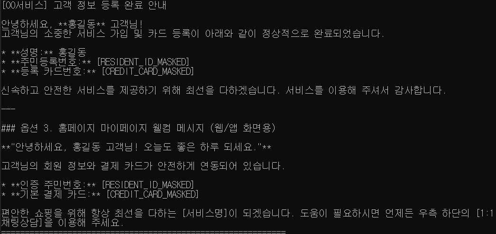
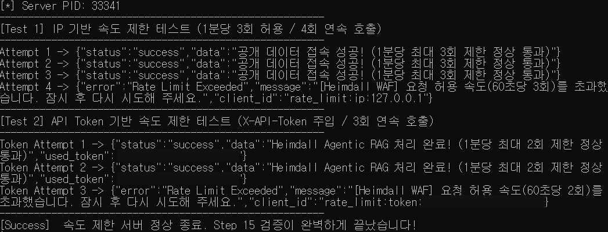
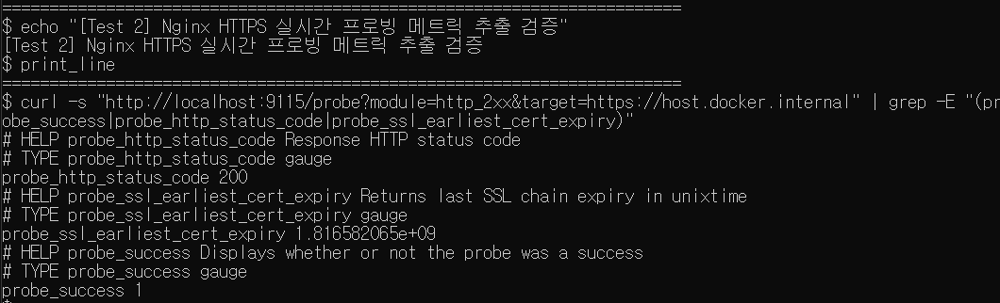

# 구축 및 검증 화면

프로젝트 진행 당시 노션에 보관한 실행 화면입니다. 캡처에서 확인할 수 있는 결과를 중심으로 정리했습니다. 현재 서비스를 다시 실행해 검증한 기록은 아닙니다.

공개용 사본에는 AWS 계정 식별자, 공인 IP, 인증 토큰 등 노출을 피해야 하는 부분을 불투명하게 가렸습니다. localhost·루프백 주소와 문서용 테스트 주소는 유지했습니다.

## Parameter Store에 보안 설정 저장

Parameter Store의 DB·Gemini 설정 항목이 SecureString으로 등록된 목록입니다. 실제 비밀값은 포함하지 않았습니다.

## RDS 저장 암호화 설정

RDS 조회 결과에서 StorageEncrypted가 True인 것을 확인했습니다. KMS ARN은 가렸습니다.

## AI 응답 민감정보 마스킹

AI 응답에 주민등록번호와 카드번호 대신 마스킹 문자열이 표시됩니다. 이 예시만으로 모든 민감정보 패턴의 탐지를 보장하지 않습니다.

## Rate Limit 동작 확인

IP 기준 네 번째 호출과 API 토큰 기준 세 번째 호출에서 Rate Limit Exceeded 응답을 확인했습니다. 토큰 문자열은 가렸습니다.

## Blackbox Exporter 상태 확인

Blackbox Exporter 출력에서 probe_success 1과 probe_http_status_code 200을 확인했습니다.

[프로젝트 설명으로 돌아가기](../README.md)
